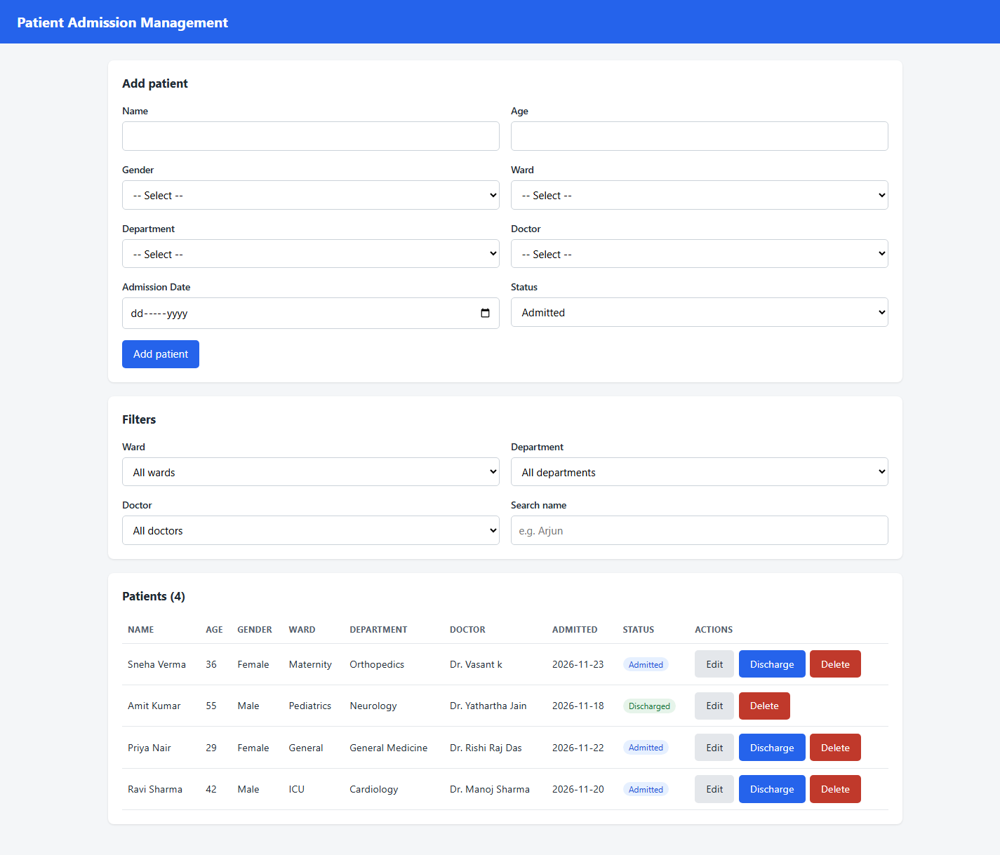
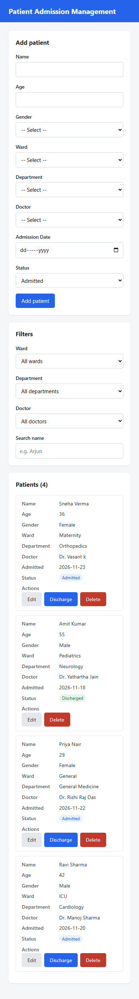

# Patient Admission Management App
## Features

- Add a patient
- View all patients
- Filter by Ward, Department or Doctor
- Search by name
- Edit a patient
- Delete a patient after confirmation
- Mark a patient as Discharged
- Responsive layout for mobile, tablet and desktop

## Tech stack

- Frontend: React.js with Vite
- Backend: Python 3 standard library (`http.server`) + `mysql-connector-python`
- Database: MySQL

Login and signup are intentionally not included.

## Project structure

```
project1.py           Python API, MySQL queries, validation, static file server
frontend/
  src/App.jsx         React UI: form, filters, table, validation
  src/main.jsx        React entry point
  src/styles.css      Responsive styles
  index.html
  vite.config.js      Dev proxy for /api
```

## Prerequisites

- Python 3
- Node.js and npm (only to build and run the React frontend)
- MySQL running locally with a database named `project`

Install Python dependencies:

```bash
pip install mysql-connector-python
```

Install frontend dependencies:

```bash
cd frontend
npm install
```

## Database settings

Credentials live in `.env`, which `.gitignore` excludes from Git:

```
DB_HOST=localhost
DB_USER=root
DB_PASSWORD=your-local-password
DB_NAME=project
```

`project1.py` reads that file at startup. All four values are required, so the
database name comes from `.env` too. Change them to your local MySQL account.
Never commit `.env` or real passwords.

For a hosted MySQL service that uses a non-default port or TLS, add these too:

```
DB_PORT=4000
DB_SSL_CA=/etc/ssl/certs/ca-certificates.crt
```

## Run

Start the Python API:

```bash
python project1.py
```

The `patients` table is created automatically on first run.

For development, start React on port 5173. It proxies `/api` to port 5000:

```bash
cd frontend
npm run dev
```

Open <http://localhost:5173>.

For a single server on port 5000, build React and let Python serve it:

```bash
cd frontend
npm run build
cd ..
python project1.py
```

Open <http://localhost:5000>.


## Validation

Both React and Python enforce the same rules:

- Name: required, letters and spaces only
- Age: required, whole number between 0 and 120
- Gender, Ward, Department, Doctor: required, chosen from fixed lists
- Admission Date: required, `YYYY-MM-DD`, not in the future
- Status: required, chosen from the fixed status list

The Python API rejects invalid data with HTTP 400 and a clear per-field error.

## API

| Method | Path | Purpose |
| --- | --- | --- |
| GET | `/api/options` | Fixed lists for the select fields |
| GET | `/api/patients` | List, with `ward`, `department`, `doctor`, `search` filters |
| POST | `/api/patients` | Add a patient |
| PUT | `/api/patients/<id>` | Edit a patient |
| PATCH | `/api/patients/<id>/discharge` | Mark as discharged |
| DELETE | `/api/patients/<id>` | Delete a patient |

## Deploy on Render

Create one Web Service in Render. It builds React and serves it together with
the Python API from the same service.

- Repository: your private GitHub repo
- Runtime: Python 3
- Build command: `npm install --prefix frontend && npm run build --prefix frontend && pip install mysql-connector-python`
- Start command: `python project1.py`
- Health check path: `/api/options`
- Environment variables: `DB_HOST`, `DB_USER`, `DB_PASSWORD`, `DB_NAME`, and
  optionally `DB_PORT`, `DB_SSL_CA`

Render sets `PORT` automatically and the app binds to it. Render does not
provide MySQL, so use an external MySQL-compatible service such as TiDB Cloud
Starter or Aiven. The `patients` table is created on first start.

## Live link

Will be added after Render deployment.

## Screenshots

Both images show the running app with sample patient records.

### Desktop



### Mobile



The mobile view shows the form stacked into one column and the patient list
rendered as cards. 
